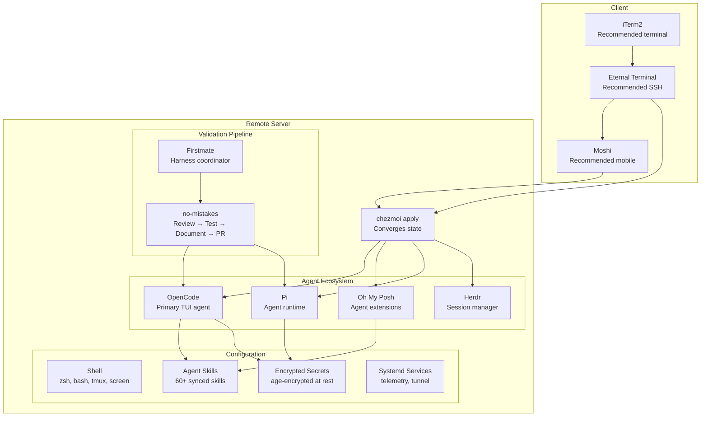

# dotfiles

Chezmoi-managed dotfiles that drive a **standardized AI-agent environment** across remote headless servers. Single source of truth for shell, editor, and agent configs — every machine converges to the same state on `chezmoi apply`.

## Why

Remote headless servers need consistent, reproducible environments for AI coding agents. This repo ensures opencode, omp, pi, and their subagents all behave identically regardless of which box you SSH into — same models, same skills, same secrets, same supervision.

## Architecture



## Recommended Stack

| Tool | Why |
|------|-----|
| **iTerm2** | Best TUI rendering for agent interfaces, proper Unicode support, split panes for parallel agent work |
| **Eternal Terminal** | Survives network drops and server reboots without losing your session — essential for long-running agent workflows |
| **Moshi** | Access agent sessions from your phone; web-based, no server-side app install needed |

### Eternal Terminal server setup

Two server patterns, each with its own install script:

| Pattern | Script | Layout | Used by |
|---|---|---|---|
| **Direct (no sslh)** | `scripts/install-et-no-sslh.sh` | sshd on `:22`, etserver directly on `0.0.0.0:2022`; both ports exposed so moshi and the laptop connect straight to the host | oci1 |
| **sslh demux** | `scripts/install-et-sslh-for-moshi.sh` | sslh on `:2022` splits SSH (to a dedicated sshd) from ET (etserver on `127.0.0.1:20220`) | other fleet hosts |

The direct pattern needs the cloud firewall (OCI NSG) to open TCP/22 and TCP/2022 and a grey-cloud (DNS-only) A record (`et.phillias.net` → oci1). The script is idempotent and hardens the exposed ports:

- `/etc/et.cfg`: `port = 2022`, `bind_ip` left unset (0.0.0.0), `telemetry = false`
- `/etc/ssh/sshd_config.d/99-et-hardening.conf`: `AllowUsers ubuntu`, `MaxAuthTries 3`, `LoginGraceTime 20`, `PermitRootLogin no`, `X11Forwarding no`. It deliberately sets no `ClientAlive*`, which would drop idle moshi/iTerm2 sessions
- iptables `recent` rate limit on `:22` and `:2022` (3 new connections per 60s per source IP, DROP on exceed), persisted to `/etc/iptables/rules.v4`

From the laptop: `et -u ubuntu et-oci1` (the `et-oci1` alias in `dot_ssh/config.tmpl` points to `et.phillias.net:22`, with no cloudflared client).

## What's Managed

| Category | Components |
|----------|-----------|
| **Shell** | zsh, bash, tmux, screen, git |
| **Agent Runtime** | OpenCode (50+ subagents, themes), Pi, Oh My Posh extensions, Herdr |
| **Agent Skills** | 60+ synced skills (CE suite, AXI tools, Cloudflare, debugging, design) |
| **Secrets** | All provider keys age-encrypted (Google, Cloudflare, Composio, Telegram, etc.) |
| **Systemd** | catalog drift, self-improvement, telemetry, Cloudflare tunnel; hermes-managed units external (honcho scheduler retired) |
| **SSH** | 6+ key pairs, all age-encrypted |

## Agent Harness

**Firstmate** is recommended as the harness coordinator for multi-agent workflows. It orchestrates agent spawning, background task supervision, away-mode daemon for token-efficient unattended operation, and fleet state tracking across parallel workers.

## Validation Pipeline

**no-mistakes** is imposed on this repo. Every change goes through automated review, testing, documentation, and PR creation — ensuring no broken config ships to production machines.

## Quick Start

```bash
# On a new machine
curl -fsSL https://raw.githubusercontent.com/phillias/dotfiles/master/scripts/setup.sh | bash
```

`scripts/setup.sh` bootstraps everything in one pass: chezmoi, then mise (the one installer for manifest-managed CLIs — gh, bw, wrangler, bws and the npm-global fleet are versioned by the committed `dot_config/mise/config.toml`), GitHub auth + deploy key, chezmoi init, Bitwarden unlock, age-key decrypt, and `chezmoi apply`. Post-apply, Phase 7b enrolls the host in the fleet SSH mesh: installs autossh, probes every `fleet-*` alias (accept-new records host keys into `known_hosts`), syncs all fleet `chezmoi@*` deploy keys into `authorized_keys`, and enables the mesh tunnel units (see `dot_agents/skills/dotfiles/refs/FLEET-TUNNELS.md`; aliases are data-driven from `.chezmoidata/fleet.toml`). Pre-mise hand-installed copies of gh/bw/wrangler in `~/bin` are removed best-effort; system copies are untouched. bws (Bitwarden Secrets CLI) is manifest-managed too: the `bitwarden-secrets-manager` registry entry (aqua backend) is pinned in `dot_config/mise/config.toml` and provisioned by the mise-sync hook on the first post-setup `chezmoi apply`. The shipped `dot_local/bin/executable_gh` (installed to `~/.local/bin/gh`) intentionally deviates from the legacy host copy: it resolves gh via PATH (skipping itself) rather than hard-coded `/usr/local/bin/gh`/`/usr/bin/gh`, so it also works on fresh mise-only hosts where no system gh binary exists.

### Mise tool management (fleet conventions)

- **Shims for PATH discovery:** `mise install` creates the tool shim (e.g. `wrangler`) for PATH discovery. Never reference versioned install directories (e.g. `installs/npm-wrangler/<ver>/...`) in configs or scripts — always use the shim.
- **Upgrade flow:** bump the pin in `dot_config/mise/config.toml` → `chezmoi apply` → mise reconciles → the shim re-points. Never run `npm update -g`, and never use in-tool self-updaters.
- **Deliberate exception — muse:** Meta's `muse` ships only as a self-updating launcher and is not npm/mise-published, so it cannot live under a mise pin. setup.sh section 19 provisions it install-if-absent from `https://api.meta.ai/muse-launcher.sh` to `~/.local/bin/muse` and never overwrites it; keep it outside mise on purpose, because its in-tool self-updater would fight the mise shim layout.
- **No duplicate symlinks:** never create duplicate `~/.local/bin` symlinks alongside the mise shim.

## Secrets

All sensitive values are age-encrypted at rest. The age key itself is stored encrypted in `age-key.txt.age` and decrypted during `chezmoi apply` using the machine's identity.

```bash
chezmoi add --encrypt ~/.config/some-app/token
```

## Machine Identity

Each machine gets its own identity via `.chezmoi.toml.tmpl` which generates machine-specific configs during apply using `chezmoi.user.name`, `chezmoi.user.email`, `chezmoi.os`, and `chezmoi.arch`.

## Contributing

1. Branch off master
2. Make changes
3. Test with `chezmoi diff` and `chezmoi verify`
4. Commit through no-mistakes pipeline
5. Open PR
6. Merge when CI passes

## License

Personal use only.

## Validation

Run `scripts/validate.sh` before shipping dotfiles changes (wired for the no-mistakes test/lint steps): renders every `.tmpl`, parses `opencode.json` and `dispatch-rules.json`, prints `chezmoi doctor` informationally.
